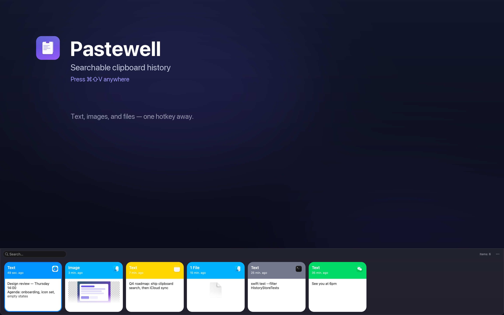

# Pastewell

A fast, private clipboard history for macOS. Copy text, images, and files as usual;
Pastewell keeps a searchable history and brings any earlier item back with one global hotkey.

Built with Swift and AppKit, sandboxed, and distributed on the Mac App Store.



> The repository and internal module names still say `ClipboardManager` / `ClipboardManagerCore`
> for historical reasons. The user-facing product is **Pastewell**.

## Features

- **Clipboard monitoring** — text, images, and files, debounced by `NSPasteboard.changeCount`
- **History** — newest-first, deduplicated, default cap 100 (configurable in Settings), persisted across restarts
- **Source app** — each entry records which app it was copied from, shown as icon + colour
- **Privacy-aware** — content marked transient or concealed (as password managers do) is never stored
- **Global hotkey** — press **⌘⇧V** anywhere to summon the picker
- **Card picker** — a bottom-anchored strip of cards with live search
- **Keyboard or mouse** — ↑/↓/←/→ to move, Return to choose an item, Esc to dismiss; or click a card
- **Copy-only by default** — the chosen item goes back on the clipboard and you press ⌘V; the
  Mac App Store build requires no special permissions
- **Pause monitoring** — stop recording clipboard changes from the menu at any time
- **34 languages** — English, Simplified Chinese, and 32 more, following the system language by default
- **Settings** — launch at login, history size, global shortcut, and language

## Download

The Mac App Store listing is coming. Tag [`v1.0.0`](../../releases/tag/v1.0.0) is the old
direct-download build (self-signed, Apple Silicon, no sandbox); it is kept for historical
reference only. New builds should be installed from the App Store.

## Requirements

- macOS 13 or later
- Apple Silicon (arm64)
- Xcode 16+ with command-line tools
- [XcodeGen](https://github.com/yonaskolb/XcodeGen) (`brew install xcodegen`)

## Build & run

```bash
make xcode      # generate Pastewell.xcodeproj from project.yml
make build      # swift build (debug, App Store variant sources)
make test       # unit tests + i18n catalog checks
make dev        # build a sandboxed Debug app with ad-hoc signing and launch it
make app        # build a sandboxed Release .app for local preview
make run        # same as make app, then open it
make mas        # App Store variant -> build/artifacts/Pastewell-MAS.app
make direct     # direct-download variant -> build/artifacts/Pastewell-Direct.app
make both       # both variants
make clean      # remove build artifacts
```

There are two build variants, selected by Xcode target and by which auto-paste
implementation is compiled:

| Variant | Target | Auto-paste | Accessibility APIs |
|---|---|---|---|
| Mac App Store | `Pastewell` | No | Not compiled or linked |
| Direct download | `PastewellDirect` | Optional (off by default) | Compiled and linked |

The two implementations live in `Sources/ClipboardManager/AutoPaste/`:
`AutoPasteEngine+MAS.swift` is a no-op stub, `AutoPasteEngine+Direct.swift` contains the
system implementation. `project.yml` includes exactly one of them per target.

`project.yml` is the single source of truth for the Xcode project; the generated
`Pastewell.xcodeproj` is intentionally not committed.

The project is preconfigured with the author's team ID (`4DQQD8M5RG`) for App Store archiving.
If you fork it, change `DEVELOPMENT_TEAM` in `project.yml` to your own team, or build
unsigned with `CODE_SIGNING_ALLOWED=NO`.

## Release

```bash
make archive              # Apple Distribution signed .xcarchive (requires a paid team account)
make export               # export build/export/Pastewell.pkg for App Store Connect
make verify               # inspect signature, entitlements, architecture, resources
```

The archive step uses the team `4DQQD8M5RG` and automatic signing. Upload the resulting
`.xcarchive` from Xcode Organizer, or upload `Pastewell.pkg` with Transporter. See
[docs/app-store/README.md](docs/app-store/README.md) for the full App Store Connect checklist.

If Xcode is not signed into the paid team, pass an App Store Connect API key from that team:

```bash
make archive \
  AUTH_KEY_PATH="$HOME/.appstoreconnect/private_keys/AuthKey_<KEY_ID>.p8" \
  AUTH_KEY_ID="<KEY_ID>" \
  AUTH_KEY_ISSUER="<ISSUER_ID>"
```

Optional pre-validation with an App Store Connect API key:

```bash
ASC_API_KEY=XXXXXXXXXX ASC_API_ISSUER=xxxxxxxx-xxxx-xxxx-xxxx-xxxxxxxxxxxx make validate
```

The key file goes in `~/.appstoreconnect/private_keys/AuthKey_<KEY_ID>.p8` (or a
`private_keys/` directory in the repo root; both are git-ignored).

## Data & privacy

Everything stays on your Mac. Pastewell has no network access, no accounts, no analytics,
and no third-party SDKs.

History lives in the app's sandbox container:

```
~/Library/Containers/com.hanqing.pastewell/Data/Library/Application Support/Pastewell/
  history.json
  images/
```

Clear it from the menu (**Clear History**) or delete the container. The App Store privacy
policy is in [docs/app-store/privacy-policy.md](docs/app-store/privacy-policy.md).

## Accessibility and the two builds

The **Mac App Store build never uses Accessibility and never requests it**. Choosing an item
puts it back on the clipboard; you press ⌘V yourself. The app does not link the Accessibility
framework at all.

The **direct-download build** additionally offers **Auto-paste on select**, which is **off by
default**. When you enable it, macOS asks for the Accessibility permission; Pastewell then
sends exactly one ⌘V to the frontmost app after you choose an item. It does not read
keystrokes, log input, or inspect other apps' content. Without the permission the app stays
fully usable in copy-only mode. Grant or revoke it in **System Settings → Privacy & Security →
Accessibility**; the menu item *Grant Accessibility Access…* opens that pane.

The “click outside to dismiss” monitor uses a global mouse monitor, which does not require
Accessibility and is present in both builds.

## Architecture

```
Sources/
  ClipboardManagerCore/        # pure logic, unit-tested (Foundation only)
    ClipboardItem.swift            model + SHA-256 content hash
    DominantColor.swift            card header colour extraction
    TransientTypeDetector.swift    transient/concealed pasteboard-type filter
    HistoryStore.swift             history, dedupe, capacity, persistence
    Preferences.swift              UserDefaults settings
    HotkeyConfig.swift             shortcut model, validation, persistence
    LanguageResolver.swift         language precedence
  ClipboardManager/            # AppKit app (product name: Pastewell)
    main.swift                     entry point
    AppDelegate.swift              wiring + status-bar menu
    PasteboardMonitor.swift        pasteboard polling
    AppIconProvider.swift          source-app icon/colour lookup, thumbnails
    ClipboardCardView.swift        the card view
    PanelController.swift          bottom picker panel, search, keyboard handling
    HotkeyManager.swift            Carbon global hotkey
    HotkeyRecorderView.swift       shortcut recorder control
    Localization.swift             L()/LocalizationManager
    SettingsWindowController.swift settings window
    Paster.swift                   clipboard write-back + synthesized ⌘V
Resources/
  Info.plist                       bundle metadata
  Pastewell.entitlements            App Sandbox
  PrivacyInfo.xcprivacy            privacy manifest
  Assets.xcassets/                 app icon
  Localizable.xcstrings            String Catalog (43 keys, 34 languages)
scripts/
  make_icon.swift                  regenerates the icon source
  verify_mas_build.sh              pre-upload checks
  ExportOptions.plist              xcodebuild export settings
Tests/
  ClipboardManagerCoreTests/       logic tests
```

### Sandbox notes

- History is containerized; the old non-sandboxed direct-download build's history is not
  migrated (the sandbox cannot read it without user selection).
- File cards copied from Finder usually show the file-type icon rather than a preview,
  because the sandbox has no security-scoped access to the original file. Image data pasted
  directly onto the pasteboard still shows a full thumbnail.
- The Carbon hotkey, `NSPasteboard` access, and `NSWorkspace` app-icon lookup all work inside
  the sandbox.

## Testing

`make test` runs the `ClipboardManagerCore` tests: content hashing and Codable round-trips,
the transient-type filter, the history store's dedupe, capacity trimming, promotion, and
persistence, shortcut validation/persistence, and language precedence. It then runs
`scripts/i18n-check.py`, which checks catalog completeness, placeholders, English
residuals, and menu-title length.

## Localization

UI strings live in a single String Catalog: `Resources/Localizable.xcstrings`. Adding a
language is a catalog edit, not a new `.lproj` folder or a project change. The app follows
the system language by default; Settings can override it, and the macOS per-app language
setting is respected when "Follow System" is selected. Language changes require a restart.
`docs/app-store/metadata-*.md` contains the App Store listing copy.

## License

MIT — see [LICENSE](LICENSE).